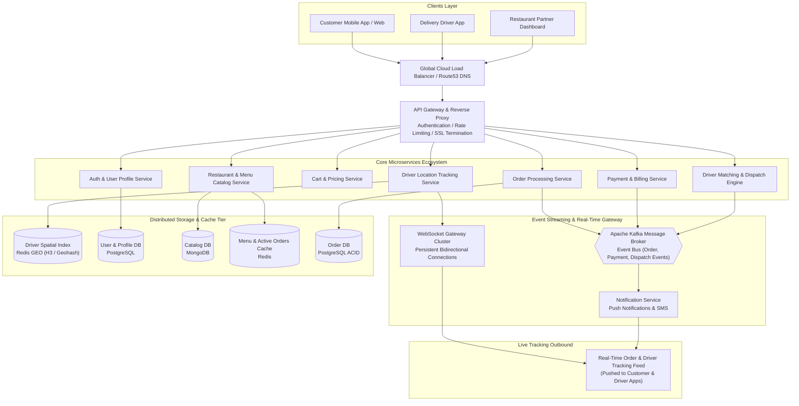
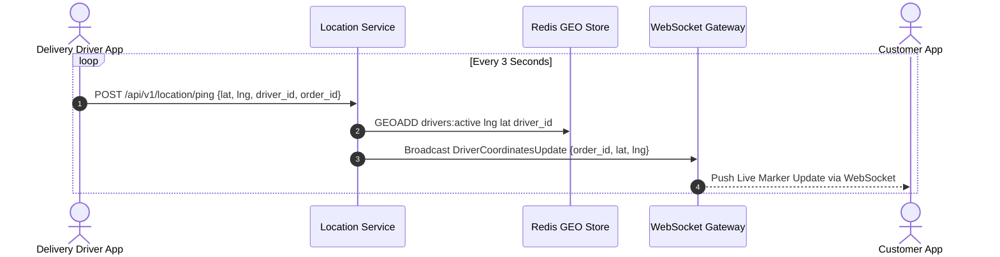

# 🍔 Question 1: Food Delivery System (Swiggy / Zomato)

**Subject**: System Design | **Subject Code**: TCS-504  
**Author**: Anubhav Singh | **Institution**: Graphic Era Hill University  
**Faculty Mentor**: Himanshu Namdev  


[](https://github.com/Anubhav-Singh-1234/system-design-hld-assignment)
[](https://github.com/Anubhav-Singh-1234/system-design-hld-assignment)
[](https://github.com/Anubhav-Singh-1234/system-design-hld-assignment)

A production-grade High-Level Design (HLD) for a hyperlocal food delivery platform like Swiggy or Zomato, engineered for ultra-low latency discovery, distributed consistency, and real-time delivery tracking.

---

## 📌 1. Requirements Engineering

### Functional Requirements (FR)
* **FR1 — User Registration and Authentication**: Support customer, delivery partner, and restaurant owner registration, JWT-based authentication, and profile/address management.
* **FR2 — Restaurant & Menu Discovery**: Search and browse restaurants by location radius (geofencing), cuisine, price, and ratings. Hierarchical menu browsing with item availability and modifiers.
* **FR3 — Cart Management & Order Placement**: Session-based cart tied to a single restaurant, live price/tax/delivery fee calculations, and ACID-compliant order placement.
* **FR4 — Online Payment Processing**: Multi-channel payment integration (UPI, Credit/Debit cards, NetBanking) with guaranteed idempotency to prevent double charges.
* **FR5 — Real-time Order & Delivery Tracking**: Live order state transitions (`PLACED` $\rightarrow$ `CONFIRMED` $\rightarrow$ `PREPARING` $\rightarrow$ `OUT_FOR_DELIVERY` $\rightarrow$ `DELIVERED`). Live delivery driver GPS tracking broadcasted to customer app every 3 seconds.

### Non-Functional Requirements (NFR)
* **High Availability**: 99.99% uptime to withstand high-volume meal surge traffic (lunch & dinner windows).
* **Low Latency**: Menu search & restaurant listing $< 100\text{ ms}$; live GPS tracking latency $< 1\text{ s}$.
* **Data Consistency**: Strict ACID consistency for financial ledger and order state; eventual consistency for analytics and catalog search.
* **Scalability**: Designed to handle $100\text{k}+$ concurrent active users and $10\text{k}+$ QPS at peak times.

---

## 🏛️ 2. High-Level Architecture




---

## 🧩 3. Component Deep Dive

| Service | Architecture & Responsibilities | Technology Stack |
| :--- | :--- | :--- |
| **API Gateway** | Request authentication, route dispatch, SSL termination, and rate-limiting using Token Bucket algorithm. | Envoy / Kong, Redis |
| **Catalog Service** | Manages restaurant metadata, opening hours, dish variations, and menu hierarchies. Read-heavy, cached extensively. | Node.js / Go, MongoDB, Redis |
| **Cart Service** | Manages transient customer cart sessions with a 60-minute TTL. Enforces single-restaurant ordering constraint. | Redis (Key-Value) |
| **Order Service** | State machine orchestrating order lifecycle; manages inventory hold and confirmation. | Java / Spring Boot, PostgreSQL |
| **Payment Service** | Integrates with Razorpay/Stripe/UPI. Handles checkout sessions, idempotency checks, and asynchronous webhook reconciliation. | Go, PostgreSQL |
| **Dispatch Engine** | Autonomous matching algorithm that assigns orders to optimal drivers within a specific Geohash bucket. | Python / Go, Redis Distributed Locks |
| **Location Service** | Ingests high-frequency GPS telemetry, updates geospatial indexes, and streams live coordinates via WebSockets. | Go, Redis GEO, WebSockets |

---

## 🗄️ 4. Data Models & Database Schemas

### 1. Restaurant & Menu Document Schema (MongoDB)
*Chosen for document-oriented flexibility to represent deeply nested menus, categories, and dynamic modifiers.*

```json
{
  "_id": "rest_10293",
  "name": "Royal Biryani House",
  "location": {
    "type": "Point",
    "coordinates": [77.5946, 12.9716]
  },
  "rating": 4.7,
  "is_open": true,
  "categories": [
    {
      "category_id": "cat_main",
      "category_name": "Main Course",
      "items": [
        {
          "item_id": "item_biryani_01",
          "name": "Dum Chicken Biryani",
          "price": 350.00,
          "is_veg": false,
          "is_available": true
        }
      ]
    }
  ]
}
```

### 2. Orders & State Ledger (PostgreSQL)
*Relational database selected to enforce strict transactional ACID boundaries on orders, payment references, and audit histories.*

```sql
CREATE TABLE orders (
    order_id UUID PRIMARY KEY DEFAULT gen_random_uuid(),
    customer_id UUID NOT NULL,
    restaurant_id VARCHAR(50) NOT NULL,
    delivery_partner_id UUID,
    delivery_address_id UUID NOT NULL,
    total_amount DECIMAL(10, 2) NOT NULL,
    status VARCHAR(30) NOT NULL CHECK (status IN (
        'CREATED', 'PAID', 'ACCEPTED_BY_RESTAURANT', 
        'PREPARING', 'OUT_FOR_DELIVERY', 'DELIVERED', 'CANCELLED'
    )),
    idempotency_key VARCHAR(100) UNIQUE NOT NULL,
    created_at TIMESTAMP WITH TIME ZONE DEFAULT CURRENT_TIMESTAMP,
    updated_at TIMESTAMP WITH TIME ZONE DEFAULT CURRENT_TIMESTAMP
);

CREATE TABLE order_items (
    order_item_id UUID PRIMARY KEY DEFAULT gen_random_uuid(),
    order_id UUID REFERENCES orders(order_id) ON DELETE CASCADE,
    item_id VARCHAR(50) NOT NULL,
    item_name VARCHAR(100) NOT NULL,
    quantity INT NOT NULL CHECK (quantity > 0),
    unit_price DECIMAL(10, 2) NOT NULL
);
```

---

## 🔄 5. Key System Workflows

### A. Order Placement & Payment Flow (Saga Pattern)
Because order processing spans across multiple independent microservices:
1. **Order Initiation**: Customer submits cart via `POST /api/v1/orders` with an `Idempotency-Key`.
2. **Order Creation**: Order Service writes a pending order (`status = 'CREATED'`) and calls the Payment Service.
3. **Payment Execution**: Payment Service generates a payment intent with the gateway. The customer authorizes UPI/Card payment.
4. **Webhook Reconciliation**: The gateway issues an asynchronous webhook callback upon transaction success.
5. **Event Publication**: Payment Service publishes `PaymentSuccessfulEvent` to Apache Kafka.
6. **Order Confirmation**: Order Service consumes the event, updates order status to `PAID`, and alerts the restaurant.
7. **Compensating Action**: If the restaurant rejects the order or no delivery partner is found within 10 minutes, an automated compensation workflow triggers a full refund.

### B. Real-Time Delivery Driver Tracking


---

## 💡 6. Deep-Dive Architectural Decisions

1. **Spatial Indexing with Geohashing & Redis GEO**:
   - Instead of running expensive SQL queries (`ST_DWithin`) on millions of rows, active driver coordinates are held in in-memory Redis sorted sets via `GEOADD`.
   - Dispatch matching uses `GEOSEARCH` within a $3\text{ km}$ to $5\text{ km}$ bounding box, yielding results in sub-millisecond time.
2. **Payment Idempotency**:
   - All payment requests require an `Idempotency-Key` header generated by the client.
   - If network drops cause the client to retry, the payment gateway checks the key and returns the original transaction state instead of charging twice.
