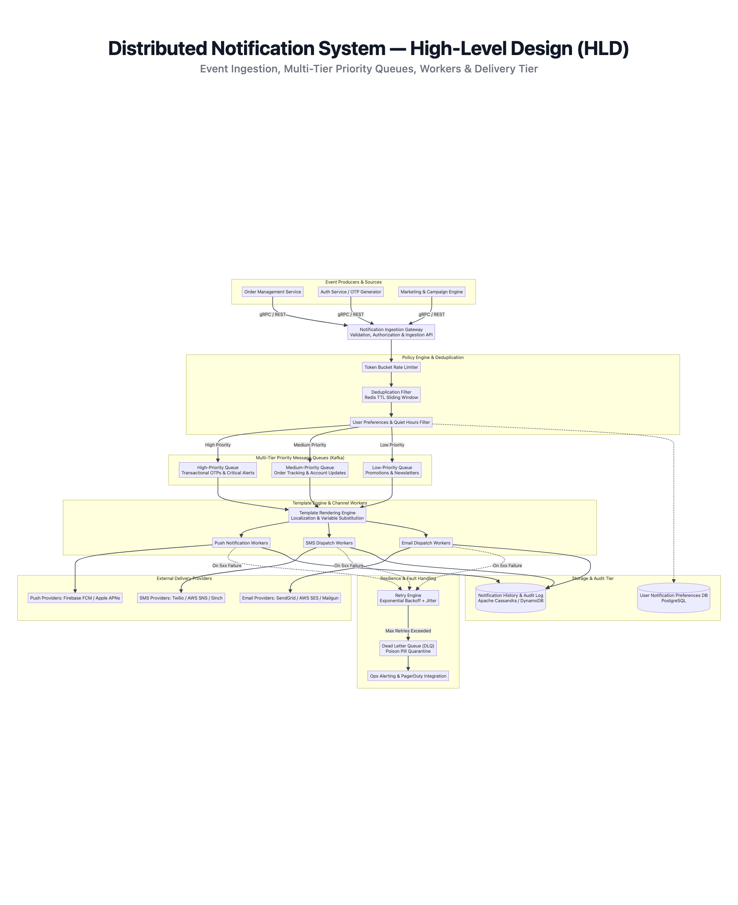
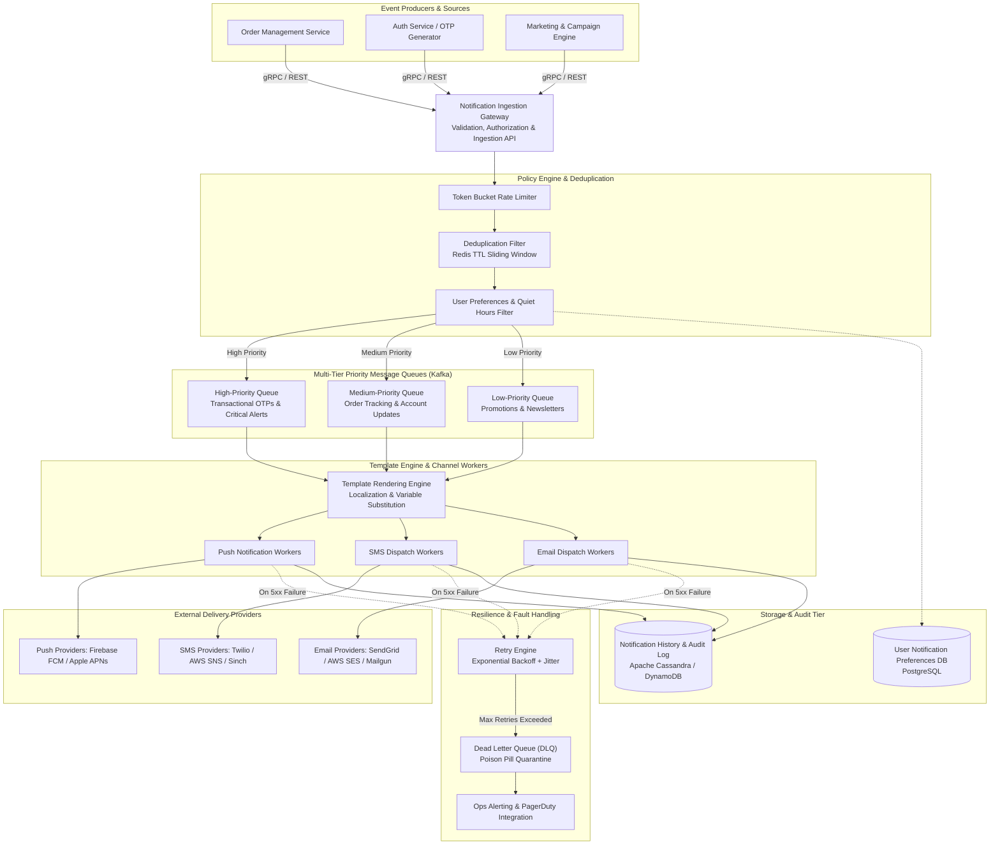
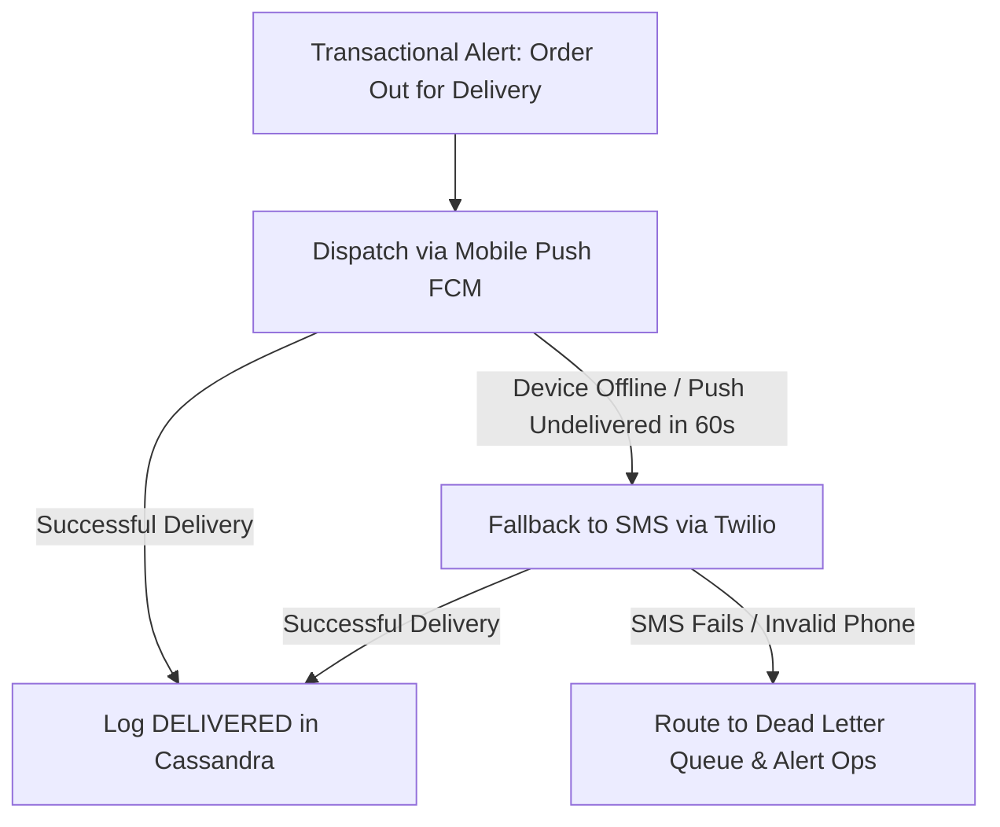

# 🔔 Question 2: Distributed Notification System

**Subject**: System Design | **Subject Code**: TCS-504  
**Author**: Anubhav Singh | **Institution**: Graphic Era Hill University  
**Faculty Mentor**: Himanshu Namdev  


[](https://github.com/Anubhav-Singh-1234/system-design-hld-assignment)
[](https://github.com/Anubhav-Singh-1234/system-design-hld-assignment)
[](https://github.com/Anubhav-Singh-1234/system-design-hld-assignment)

A highly available, resilient, multi-channel notification engine capable of handling millions of transactional, promotional, and scheduled messages with guaranteed delivery, intelligent deduplication, and exponential backoff retry.

---

## 📌 1. Requirements Engineering

### Functional Requirements (FR)
* **FR1 — User Preferences & Registration**: Users can register and configure multi-channel delivery preferences (Email, SMS, Push) and category subscriptions (Order Updates, Reminders, Marketing).
* **FR2 — Multi-Channel Dispatch**: Seamlessly routes notifications through Push (FCM / APNs), SMS (Twilio / AWS SNS), and Email (SendGrid / AWS SES).
* **FR3 — Tiered Notification Priorities**:
  - *High-Priority / Transactional*: OTPs, order state changes, security alerts (delivered $< 3\text{ s}$).
  - *Medium-Priority*: Scheduled delivery reminders, calendar alerts.
  - *Low-Priority*: Marketing campaigns, bulk newsletters.
* **FR4 — Notification History & Lifecycle Tracking**: Persistent audit log recording states: `QUEUED` $\rightarrow$ `SENT` $\rightarrow$ `DELIVERED` $\rightarrow$ `READ` $\rightarrow$ `FAILED`.
* **FR5 — Fault Tolerance & Retry Architecture**: Exponential backoff retry with jitter, Dead Letter Queues (DLQ) for unrecoverable failures, and automatic channel fallback (e.g. Push $\rightarrow$ SMS).

### Non-Functional Requirements (NFR)
* **High Throughput**: Capable of ingesting and dispatching $> 100\text{k}$ notifications per minute.
* **Zero Duplicate Deliveries (Idempotency)**: Ensures users never receive duplicate alerts during retry spikes.
* **Low Latency**: Transactional notifications delivered in $< 3\text{ seconds}$.
* **Compliance & Quiet Hours**: Honors localized user quiet hours (e.g., 10 PM – 7 AM) and regulatory DND lists.

---

## 🏛️ 2. High-Level Architecture



<details>
<summary><b>View Architecture Source (Mermaid)</b></summary>


</details>

---

## 🗄️ 3. Database & Audit Log Schemas

### 1. User Notification Preferences (PostgreSQL)
```sql
CREATE TABLE notification_preferences (
    user_id UUID PRIMARY KEY,
    email_enabled BOOLEAN DEFAULT TRUE,
    sms_enabled BOOLEAN DEFAULT TRUE,
    push_enabled BOOLEAN DEFAULT TRUE,
    promotional_enabled BOOLEAN DEFAULT FALSE,
    order_updates_enabled BOOLEAN DEFAULT TRUE,
    quiet_hours_start TIME DEFAULT '22:00:00',
    quiet_hours_end TIME DEFAULT '07:00:00',
    updated_at TIMESTAMP WITH TIME ZONE DEFAULT CURRENT_TIMESTAMP
);
```

### 2. High-Throughput Notification History (Apache Cassandra CQL)
*Cassandra is chosen for append-heavy write throughput ($100\text{k}+$ writes/sec) with partitioning by `user_id`:*

```sql
CREATE TABLE notification_history (
    user_id UUID,
    notification_id UUID,
    channel VARCHAR,            -- 'EMAIL', 'SMS', 'PUSH'
    category VARCHAR,           -- 'ORDER_STATUS', 'OTP', 'REMINDER'
    status VARCHAR,             -- 'QUEUED', 'SENT', 'DELIVERED', 'FAILED'
    retry_count INT,
    error_message TEXT,
    created_at TIMESTAMP,
    delivered_at TIMESTAMP,
    PRIMARY KEY ((user_id), created_at, notification_id)
) WITH CLUSTERING ORDER BY (created_at DESC);
```

---

## 🔁 4. Retry Architecture & Channel Fallback

### 1. Exponential Backoff with Jitter
For temporary provider downtime or HTTP 429 (Too Many Requests), delays are calculated as:
$$\text{Delay} = \min\left(t_{\max}, t_{\text{base}} \times 2^{\text{attempt}}\right) + \text{random\_jitter}$$

* **Attempt 1**: $1\text{ s} + \text{jitter}$
* **Attempt 2**: $2\text{ s} + \text{jitter}$
* **Attempt 3**: $4\text{ s} + \text{jitter}$
* **Attempt 4**: $8\text{ s} + \text{jitter}$

### 2. Intelligent Channel Fallback Flow

