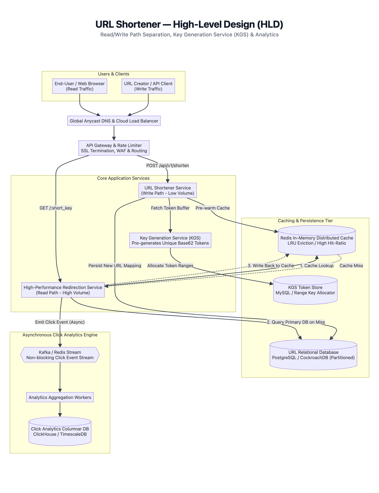
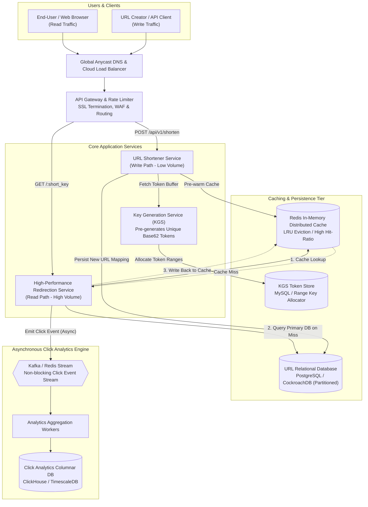
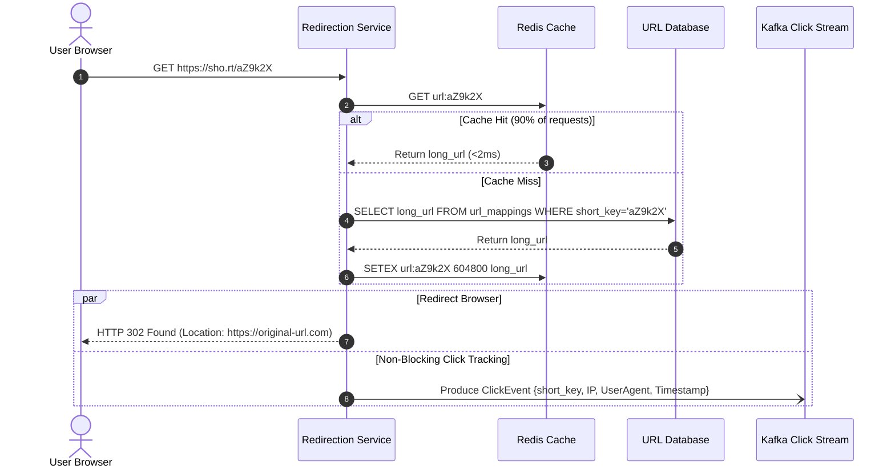

# 🔗 Question 3: URL Shortener (Bitly)

**Subject**: System Design | **Subject Code**: TCS-504  
**Author**: Anubhav Singh | **Institution**: Graphic Era Hill University  
**Faculty Mentor**: Himanshu Namdev  


[](https://github.com/Anubhav-Singh-1234/system-design-hld-assignment)
[](https://github.com/Anubhav-Singh-1234/system-design-hld-assignment)
[](https://github.com/Anubhav-Singh-1234/system-design-hld-assignment)

A highly scalable, ultra-low latency distributed URL shortening platform engineered to handle billions of redirects with Base62 token generation, in-memory caching, and asynchronous Kafka click analytics.

---

## 📌 1. Requirements Engineering

### Functional Requirements (FR)
* **FR1 — URL Shortening**: Accepts an arbitrary long URL and generates a compact, unique, URL-safe short link (e.g. `https://sho.rt/aZ9k2X`).
* **FR2 — High-Speed Redirection**: Navigating to the short URL instantly redirects the user to the destination long URL.
* **FR3 — Persistent Mapping**: Reliable bidirectional storage of short keys and original URLs with optional expiration dates (TTL).
* **FR4 — Real-Time Click Analytics**: Records every click event (timestamp, IP, location, user-agent, referrer) without increasing redirect latency.
* **FR5 — Custom Vanity URLs (Bonus)**: Allows users to specify customized vanity aliases (e.g., `sho.rt/system-design`).

### Non-Functional Requirements (NFR)
* **Ultra-Low Latency Redirection**: Target redirection latency $< 15\text{ ms}$.
* **Extreme Read-to-Write Ratio**: System is designed for a **100:1 Read-to-Write ratio**.
* **High Availability**: 99.999% availability; redirect service must never go down.
* **Unpredictability**: Short URL keys must not be guessable sequentially to prevent scraping attacks.

---

## 🏛️ 2. High-Level Architecture



<details>
<summary><b>View Architecture Source (Mermaid)</b></summary>


</details>

---

## 🔢 3. Key Generation Strategy: Base62 & KGS

### Mathematical Capacity
Using Base62 characters: `[0-9]`, `[a-z]`, `[A-Z]` ($10 + 26 + 26 = 62\text{ characters}$):
$$\text{Total Capacity for 7 Characters} = 62^7 = 3,521,614,606,208 \approx 3.52\text{ Trillion URLs}$$
Even at **1,000 new URLs created per second**, this keyspace will sustain over **111 years** of continuous generation without exhaustion!

### Comparison of Generation Approaches

| Generation Method | Pros | Cons | Verdict |
| :--- | :--- | :--- | :---: |
| **MD5 / SHA-256 + Truncation** | Deterministic mapping. | Suffers from **hash collisions**; requires expensive DB lookups on insert. | ❌ Suboptimal |
| **Auto-Increment Counter + Base62** | Zero collisions; very fast. | **Predictable** (`abc1`, `abc2`), allowing adversaries to crawl all links. | ⚠️ Security risk |
| **Dedicated Key Generation Service (KGS)** | **$O(1)$ zero-collision allocation**, completely non-predictable, zero DB locking on write. | Requires maintaining a separate key pool service. | ✅ **Selected Choice** |

---

## 🗄️ 4. Database Schema & Cache Design

### 1. URL Mappings Table (Relational or NoSQL)
```sql
CREATE TABLE url_mappings (
    short_key VARCHAR(10) PRIMARY KEY,     -- e.g. 'aZ9k2X'
    long_url TEXT NOT NULL,
    user_id UUID,                          -- NULL for anonymous links
    click_count BIGINT DEFAULT 0,
    created_at TIMESTAMP WITH TIME ZONE DEFAULT CURRENT_TIMESTAMP,
    expires_at TIMESTAMP WITH TIME ZONE DEFAULT NULL
);

CREATE INDEX idx_expires_at ON url_mappings(expires_at);
CREATE INDEX idx_user_id ON url_mappings(user_id);
```

### 2. Redis Caching Strategy (Cache-Aside Pattern)
* **Hit Ratio**: Expected $\ge 90\%$ for hot URLs.
* **Storage Key**: `url:{short_key}` $\rightarrow$ `long_url` string.
* **Eviction Policy**: **allkeys-lru** (Least Recently Used) ensures stale URLs make room for viral links in memory.

---

## 🔀 5. Redirection Workflow: HTTP 301 vs 302 Deep Dive



### Why `HTTP 302 Found` instead of `301 Moved Permanently`?
* **`301 Moved Permanently`**: The browser caches the redirect mapping permanently. Subsequent clicks bypass the URL shortener entirely.
  - *Major Flaw*: **Analytics tracking is completely broken**, making click counting impossible!
* **`302 Found`**: The browser requests the shortener on every visit.
  - *Key Benefit*: **100% accurate real-time analytics**, click counts, and geo-tracking on every click.
  - *Performance*: Sub-15 ms redirect maintained effortlessly via Redis RAM cache.

---

## 📊 6. Asynchronous Click Tracking Pipeline

1. **Non-Blocking Ingestion**: When redirecting, the Redirection Service dispatches a lightweight JSON event to an **Apache Kafka** topic in background without waiting.
2. **Batch Aggregation**: Dedicated analytics workers consume batches of 500 events from Kafka.
3. **Columnar Ingestion**: Events are bulk-written to **ClickHouse** or **TimescaleDB**, providing rapid aggregation queries for analytics dashboards (e.g. clicks by country, browser, referrer).
